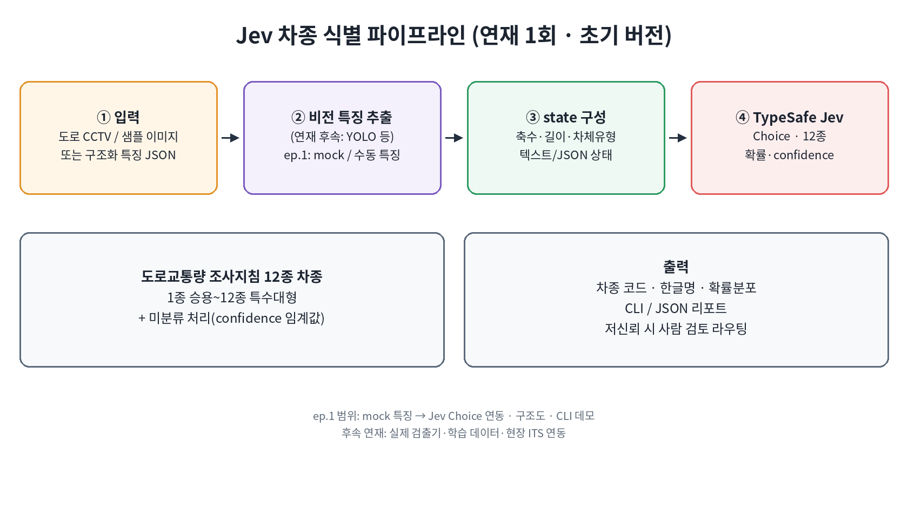

# Jev 차종 분류 (연재 1회)

최규선(Choi Gyuseon, 정보관리기술사, ITS)의 공개 연재입니다.
도로를 지나는 차를 **도로교통량 조사지침 12종** 중 하나로 고릅니다.
마지막 선택은 [TypeSafe Jev](https://docs.typesafe.ai/concepts/system-one)의 Choice입니다.

이번 v0.1은 뼈대입니다. 카메라 모델은 아직 없고, 사람이 만든 특징 JSON으로
같은 길을 걸어 봅니다. 다음 회차에 YOLO 같은 검출기를 앞에 붙여도
Jev에 묻는 질문과 12개 코드는 그대로 둡니다.

## 무엇을 하나요

교통량을 차종별로 세려면 차종이 먼저 정해져야 합니다.
지침의 12종은 코드로 고정할 수 있지만, 축이 잘 안 보이거나
버스인지 화물차인지 애매한 경우는 규칙 몇 줄로 끝나지 않습니다.

그래서 일을 나눕니다.

1. **비전**이 화소에서 축수, 길이, 차체 힌트를 뽑습니다. 이번 회차는 이 자리를 mock이 대신합니다.
2. 그 힌트를 **state**라는 JSON으로 정리합니다.
3. **Jev Choice**가 12종 중 하나를 고르고, 종마다 확률과 confidence를 줍니다.
4. confidence가 낮으면 프로그램이 `needs_review`로 사람 검토에 보냅니다.

## 왜 이미지를 Jev에 바로 넣지 않나요

Jev는 사진을 분류하는 CNN이 아닙니다.
글을 읽고 **정해진 답 중 하나**를 고르는 결정 모델입니다.
입력은 텍스트, JSON, 텍스트 배열입니다. 연재 1회의 본 경로는 이미지가 아닙니다.

검출기는 바뀝니다. YOLO가 될 수도 있고, 현장 검지기 값이 될 수도 있습니다.
Jev에게 필요한 것은 "이 차가 몇 축이고, 대략 얼마나 길며, 화물칸이 있는지"입니다.
그 문장을 JSON으로 고정해 두면 앞단을 통째로 갈아 끼워도 Choice 층은 유지됩니다.

```text
영상 또는 샘플 JSON → 특징(VehicleFeatures) → state JSON → Jev Choice → 12종 + 확률
                                                         └ confidence가 낮으면 needs_review
```

## 구조



그림의 네 칸은 한 방향으로만 흐릅니다.

| 칸 | 이번 회차에서 |
| --- | --- |
| ① 입력 | 도로 CCTV를 가정합니다. 실제로는 샘플 JSON을 읽습니다. |
| ② 비전 특징 추출 | `MockVisionExtractor`. 이미지를 열지 않고, 가중치도 받지 않습니다. |
| ③ state | `VehicleFeatures.to_state()`. 축수·길이·차체·톤수 힌트·견인 여부. |
| ④ Jev | `Choice` 하나. 선택지는 `class_01` … `class_12`. |

아래 왼쪽 칸의 "미분류"는 13번째 차종이 아닙니다.
confidence가 임계값보다 낮을 때 사람 검토로 보내는 처리입니다.
오른쪽 칸이 CLI와 JSON 리포트입니다.

이후 회차 계획은 [docs/SERIES.md](docs/SERIES.md)에 있습니다.

## 준비

Python 3.10 이상이 필요합니다.

```bash
python3 -m venv .venv
source .venv/bin/activate
pip install -e ".[dev]"
pytest
```

`pip install -e .` 만으로도 패키지는 설치됩니다.
mock 모드와 테스트는 `typesafe-sdk`와 API 키가 없어도 됩니다.

## 빠른 시작 — mock (키 없음)

```bash
python -m jev_vehicle classify --sample sedan --mock
python -m jev_vehicle classify --sample truck3axle --mock
python -m jev_vehicle classify --sample bus --mock
```

각 실행은 차종 코드, 한글명, 12칸 확률, confidence를 출력합니다.
파일로 넣어도 됩니다.

```bash
python -m jev_vehicle classify --features examples/sample_features/motorcycle.json --mock
python -m jev_vehicle classify --sample ambiguous --mock
python -m jev_vehicle classes
```

`ambiguous`는 야간이라 축과 차체를 모르는 샘플입니다.
데모가 12종 중 하나로 기울이더라도 `needs_review: true`가 됩니다.

JSON이 필요하면 `--json`을 붙입니다.

## 빠른 시작 — live (Jev)

키는 [TypeSafe 콘솔](https://docs.typesafe.ai/introduction/quickstart)에서 발급합니다.
저장소에 넣지 마세요.

```bash
pip install -e ".[live]"
cp .env.example .env
# .env에 TYPESAFE_API_KEY=... 를 적습니다.
set -a && source .env && set +a
python -m jev_vehicle classify --sample sedan --live
```

`--mock`도 `--live`도 없으면, 키가 있을 때만 Jev를 호출합니다.
키가 없으면 mock입니다. 호출에 쓰는 모델 이름은 `jev-latest`입니다.

```python
from typesafe_sdk import Choice, TypeSafeClient

with TypeSafeClient(model="jev-latest") as client:
    response = client.system_one(state=state, questions={"vehicle_class": question})
answer = response.choices["vehicle_class"]
answer.choice          # "class_01" 같은 코드
answer.probabilities   # 12종 확률
answer.confidence      # 0~1. 분포가 한곳에 몰릴수록 큽니다.
```

질문 문장과 영어 경계는 `jev_vehicle.classifier.vehicle_class_question()`에 있습니다.
한글 차종명은 각 criteria의 `name_ko`와 `what` 앞에 있습니다.
Jev의 주 학습 언어가 영어라, 축수·톤수처럼 헷갈리는 경계는 영어로 적었습니다.

## 12종

코드는 연재가 바뀌어도 유지합니다.

| 코드 | 번호 | 한글명 | 이번 회차에서 가르는 힌트 |
| --- | --- | --- | --- |
| `class_01` | 1 | 승용차 | 사람만 태우는 승용. 화물칸 없음 |
| `class_02` | 2 | 버스(좌석) | 입석 없는 고속·시외·전세 |
| `class_03` | 3 | 버스(입석) | 입석이 되는 도시형 버스 |
| `class_04` | 4 | 소형화물(1톤 이하) | 1톤 이하 카고 |
| `class_05` | 5 | 중형화물(1~2.5톤) | 1톤 초과, 2.5톤 이하 |
| `class_06` | 6 | 대형화물(2.5톤 초과, 2축) | 2.5톤 초과이면서 축이 2개 |
| `class_07` | 7 | 대형화물(3축) | 단일 차체, 축 3개 |
| `class_08` | 8 | 대형화물(4축) | 단일 차체, 축 4개 |
| `class_09` | 9 | 대형화물(5축) | 단일 차체, 축 5개 |
| `class_10` | 10 | 특수(견인) | 트레일러를 끄는 트랙터 |
| `class_11` | 11 | 특수(피견인) | 자체 동력이 없는 트레일러 |
| `class_12` | 12 | 이륜차 | 이륜차 |

작업용 경계는 이렇습니다. 1톤 이하는 4종, 1톤을 넘고 2.5톤까지는 5종,
2.5톤을 넘으면서 2축이면 6종입니다. 견인차와 피견인차는 한 덩어리로
세지 않고 10종과 11종으로 나눕니다. 현장 지침의 예외는 데이터 회차에서
다시 맞춥니다.

내장 샘플은 `examples/sample_features/`에 있고, 같은 파일이 패키지 안에도
들어 있습니다. CLI `--sample`은 패키지 쪽을 읽습니다.

| 샘플 | 기대하는 데모 결과 |
| --- | --- |
| `sedan` | 승용차 |
| `bus`, `bus_seated` | 버스(좌석) |
| `bus_city` | 버스(입석) |
| `truck_small` | 소형화물 |
| `truck_medium` | 중형화물 |
| `truck2axle` | 대형화물 2축 |
| `truck3axle` | 대형화물 3축 |
| `truck4axle` | 대형화물 4축 |
| `truck5axle` | 대형화물 5축 |
| `tractor` | 특수(견인). 축이 3개여도 7종이 아닙니다 |
| `trailer` | 특수(피견인) |
| `motorcycle`, `bike` | 이륜차 |
| `ambiguous` | 12종 중 하나로 기울지만 `needs_review` |

## 낮은 confidence

Choice는 항상 12개 중 하나를 고릅니다. "모르겠다"를 선택지에 넣지 않은
이유는, 그러면 확률이 차종이 아닌 쪽으로 빠지고 집계 코드가 지침과
어긋나기 때문입니다. 모르는 상태는 답의 종류가 아니라 **다음 행동**입니다.

```text
confidence < 임계값  →  needs_review  (사람 검토)
그 외                →  auto          (집계에 사용)
```

기본 임계값은 `0.45`입니다. 12지선다에서 이 값은 대략 최상위 확률 0.50에
해당합니다. TypeSafe의 confidence는 "고른 차종이 맞을 확률" 그 자체가
아니라, 확률이 한 선택지에 얼마나 몰렸는지를 0~1로 요약한 값입니다.
연재 1회 숫자는 자리표시자입니다. 현장 라벨로 바꾸는 작업은
[docs/SERIES.md](docs/SERIES.md)의 연재 4회입니다.

임계값을 잠깐 바꿔 볼 수 있습니다.

```bash
python -m jev_vehicle classify --sample sedan --mock --threshold 0.99
```

## 코드 지도

```text
src/jev_vehicle/classes.py       12종 코드, 한글명, Choice criteria
src/jev_vehicle/features.py      VehicleFeatures, to_state()
src/jev_vehicle/vision_mock.py   연재 1회 추출기. extract()가 계약입니다
src/jev_vehicle/classifier.py    Jev 호출, MockJevClient, needs_review
src/jev_vehicle/cli.py           python -m jev_vehicle
examples/sample_features/       샘플 특징 JSON
tests/                           키 없이 도는 단위 테스트
```

연재 2에서 검출기를 붙일 때는 `extract()`가 같은 `VehicleFeatures`를
돌려주게 하면 됩니다. `classify(features)` 이후는 바꾸지 않습니다.

```python
from jev_vehicle import classify
from jev_vehicle.vision_mock import load_sample

features = load_sample("sedan")   # 나중에는 yolo.extract(image_path)
result = classify(features, mock=True)
print(result.class_code, result.name_ko, result.confidence, result.needs_review)
```

특징 JSON에 정답 코드는 넣지 않습니다. 번호판, 얼굴, 영상 바이트도
필드가 아닙니다.

## 주의

`MockJevClient`는 오프라인 데모입니다. 지침의 공식 판정도 아니고,
Jev의 응답도 아닙니다. 축·차체·톤수 힌트가 분명한 샘플을 항상 같은
차종으로 돌려 테스트가 네트워크 없이 통과하게 만든 규칙입니다.
운영 교통량을 이 규칙으로 집계하지 마세요. 실사용은 `--live`입니다.

## 연재

| 회차 | 상태 | 내용 |
| --- | --- | --- |
| 1회 v0.1 | 완료 | mock 특징, state, Jev Choice, CLI, 검토 라우팅 자리 |
| 2회 | 계획 | YOLO 등 실제 검출. Jev 입력은 계속 state |
| 3회 | 계획 | 라벨 데이터와 혼동행렬 |
| 4회 | 계획 | confidence 임계값 보정 |
| 5회 | 계획 | VDS·센터·사람 검토 큐 |

자세한 설명은 [docs/SERIES.md](docs/SERIES.md)입니다.

## 라이선스

[MIT](LICENSE). 지침 문장과 TypeSafe 문서의 저작권은 각 권리자에게 있습니다.
이 저장소는 그 지침을 코드로 가져오는 실습용 골격입니다.

## 문서

- [TypeSafe 빠른 시작](https://docs.typesafe.ai/introduction/quickstart)
- [System One](https://docs.typesafe.ai/concepts/system-one)
- [State](https://docs.typesafe.ai/concepts/state)
- [Choice](https://docs.typesafe.ai/primitives/choice)
- [Confidence](https://docs.typesafe.ai/confidence)
- [Python SDK](https://docs.typesafe.ai/sdk/python)
- [TypeSafe skill](https://github.com/typesafe-ai/skills/blob/main/skills/typesafe-ai/SKILL.md)
